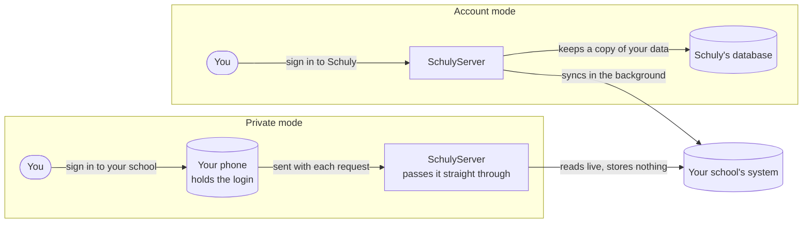

# App modes

Use this page to see how the two app modes differ. You choose a mode at the gate. Both modes read
the same school systems from the same backend catalog. They differ in who signs you in, where your
login is kept, and whether data rests on a server. The app hardcodes no school system.

| | Account mode | Private mode |
| --- | --- | --- |
| Auth to Schuly | Schuly account bearer token | None |
| HTTP client | `ApiClient` (auth interceptor) | Clean `Dio`, anonymous endpoints only |
| Where data lives | Server side, in Postgres | On the device only |
| Backend role | Stores data and syncs in the background | Live stateless proxy, stores nothing |
| Provider selection | Per connected account | Catalog `privateAuthStrategy` (`token` or `scrape`) |

## What private mode does on the device

- The app writes the school login to the device keystore. The login leaves the device only when the
  app sends it to the school system through the backend's anonymous proxy endpoints.
- The connect screen is generic. It renders the login fields the catalog lists for your school and
  follows the catalog's `privateAuthStrategy`:
  - `token`: a headless login creates a bearer token and a refreshable session.
  - `scrape`: the app sends the credentials again on each fetch.
- If your school uses a one-time code, the app stores its seed with the login. The **Authenticator**
  screen generates codes on the device.
- When a session expires, the app reconnects from the keystore without asking you to sign in.
